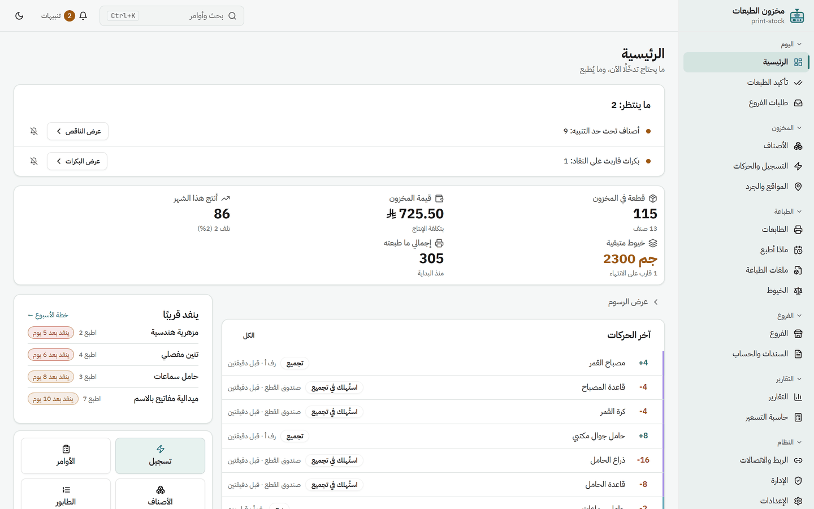
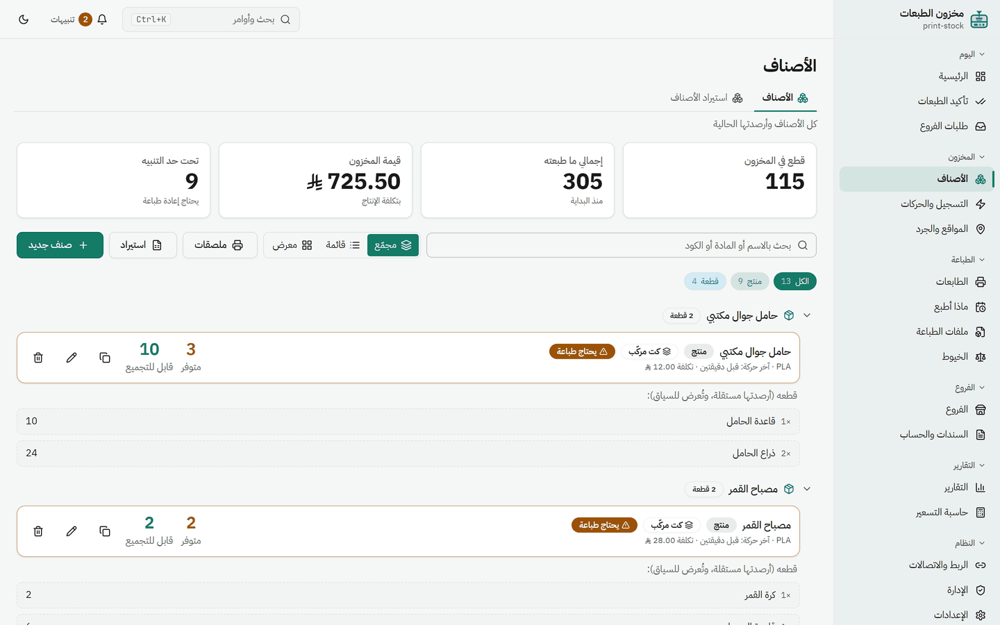
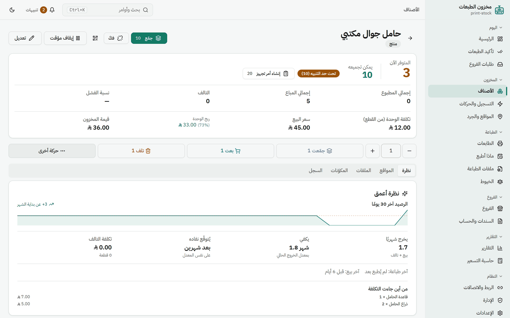
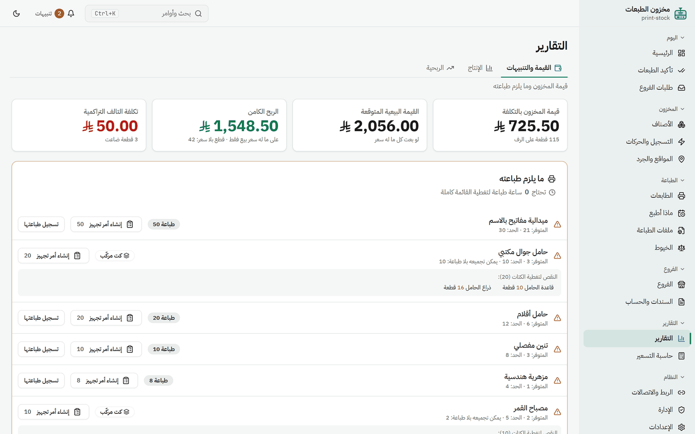
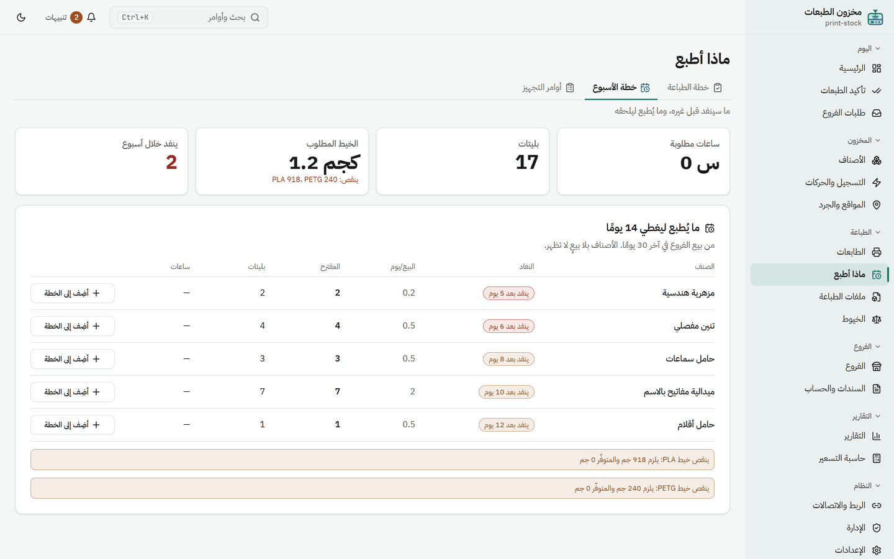
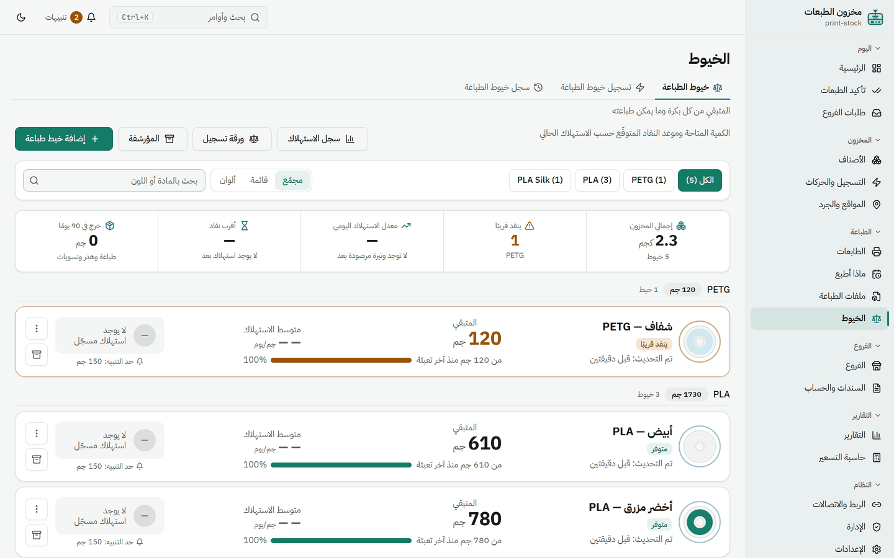
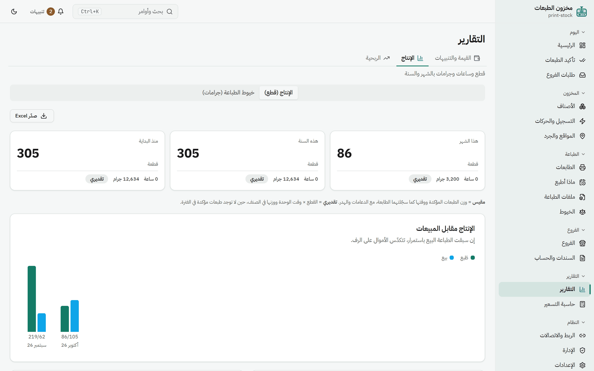
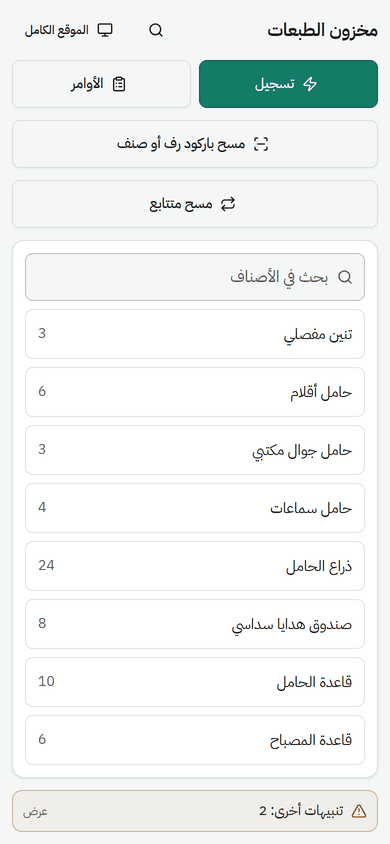
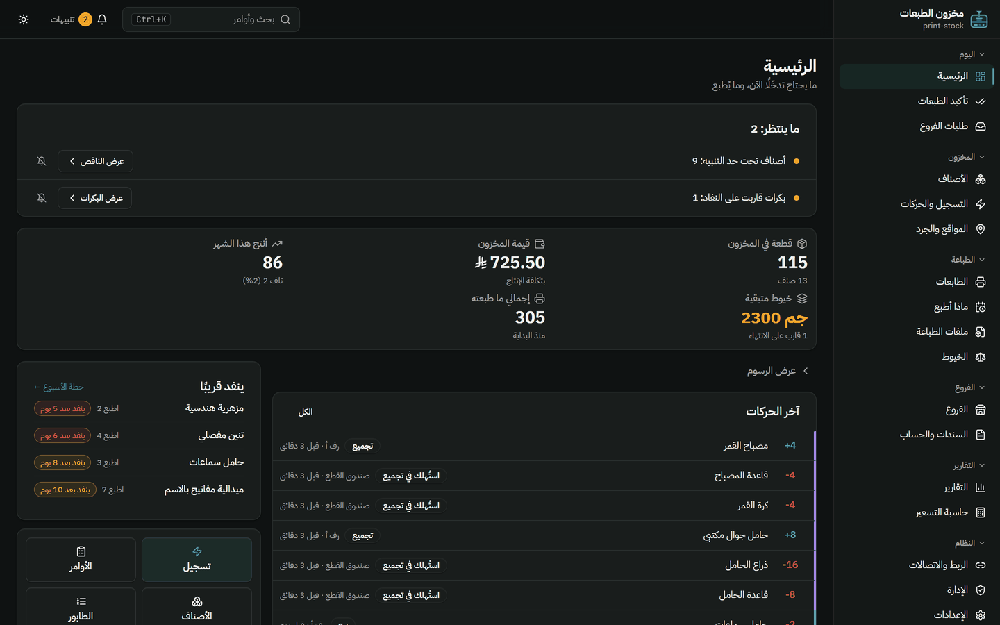

# مخزون الطبعات · print-stock

**كم عندك · كم طبعت · كم يساوي مخزونك · وش تطبع الليلة**

نظام مخزون لمشاريع الطباعة ثلاثية الأبعاد بطابعات Bambu Lab —
واجهة عربية بالكامل، ويعمل على جهازك بلا إنترنت ولا حساب.

## لماذا هذا التطبيق؟

من يطبع ويبيع يعيش بين ثلاثة أسئلة لا يجيب عنها دفتر ولا جدول إكسل:

| السؤال | الجواب في التطبيق |
|---|---|
| **كم عندي فعلًا؟** | الرصيد **يُحسب من الحركات** ولا يُكتب بيد — كل رقم يُفسَّر حركةً حركة |
| **كم يساوي مخزوني؟** | القيمة بالتكلفة وبسعر البيع، والربح الكامن، وتكلفة التالف |
| **وش أطبع الليلة؟** | ما سينفد قبل غيره بمعدّل البيع الحقيقي — والكت المركّب يُجمَّع قبل أن يُطبع |

والطابعة نفسها جزء من النظام: **تنتهي الطبعة فتصلك للتأكيد**، بضغطة تُضاف القطع
للمخزون ويُخصم الخيط — بلا إدخال مزدوج.

---

## أبرز ما فيه

### 📦 مخزون يُحسب ولا يُخمَّن

- **سجلّ حركات لا يُمحى**: طباعة · بيع · تالف · مرتجع · نقل · تجميع — والتصحيح بحركة عكسية
- **الكتات**: قطعتان تُجمَّعان منتجًا، ولكل كت رقمان — كم مجمَّع فعلًا، وكم **يمكن تجميعه**
- **المواقع**: غرف ورفوف وصناديق بملصقات QR، ورصيد كل مكان

### 🔍 صفحة لكل صنف

تكلفة الوحدة من قطعها، وربحها ونسبته، ومنحنى الرصيد، و**متى ينفد على المعدّل الحالي**.

### 💰 القيمة وما يلزم طباعته

### 🗓️ خطة الأسبوع

مرتّبة بموعد النفاد، مع البليتات المطلوبة، و**تنبيه حين لا يكفي الخيط** قبل أن تبدأ.

### 🧵 خيوط الطباعة بالجرام

كم بقي من كل بكرة، ومتى تنفد بحسب استهلاكك — وتُخصم مع تأكيد الطبعة بوزن الطابعة الفعلي.

### 📊 تقارير الإنتاج

### 🖨️ الطابعات

- **حالة حيّة لطابعات Bambu**: وش تطبع الآن، ومتى تفرغ
- **تأكيد الطبعات**: الطابعة تقول اسم المهمة، وأنت تقول أي صنف وكم خرج صالحًا
- **الطابور**: ترتيب الطبعات القادمة — ولا يُرسل شيء إلا باعتمادك

### 📱 وعلى الجوال

نسخة مختصرة تُثبَّت كتطبيق: سجّل · تابع · امسح باركود الرف أو الصنف.

ووضع داكن كامل، وقفل برقم سري.

 

<b>الوضع الداكن</b>

 

> الصور من بيانات عرض وهمية.

---

## التشغيل — ولا يحتاج جهازك تثبيت أي شيء

١. نزّل الـzip من [الإصدارات](https://github.com/relifeg1/print-stock-releases/releases/latest) وافتحه في أي مجلد.
٢. شغّل **«مخزون الطبعات.bat»** — يفتح المتصفح على شاشة التهيئة.
٣. ثلاث خطوات، ويشتغل.

المشغّل (`node.exe`) **داخل المجلد**، فلا تحتاج تثبيت Node ولا أي برنامج.
ولاختصارٍ على سطح المكتب وتشغيلٍ مع الويندوز: افتح **«ثبّت الاختصارات.bat»** مرة واحدة.

## وين بياناتي؟

**على جهازك وحده.** تختار في شاشة التهيئة:

- **على جهازي** — الأسهل، بلا حساب ولا إنترنت. بياناتك في مجلد `data`.
- **في السحابة** — قاعدة مجانية على [neon.tech](https://neon.tech)، فتفتح مخزونك من الجوال ومن جهازٍ ثانٍ.

وتنقلها بينهما وقت ما تشاء من: **الإعدادات ← مكان بياناتك ← انقلها**.

> **لا خادمَ مشتركًا ولا حسابات.** كل نسخة مستقلّة ببياناتها. من ينزّل
> التطبيق يجد شاشة فارغة وبياناته وحده.

## النسخ الاحتياطي

يُكتب وحده عند كل تشغيل وكل ٢٤ ساعة في مجلد `backups`.
ونزّل نسخةً على مكانٍ ثانٍ من: **الإعدادات ← نزّل نسخة على جهازي** — والاستعادة من نفس الصفحة.

> **وبياناتك مسؤوليتك**: من يمسك مخزون رزقه ببرنامجٍ على جهازٍ واحد يجب أن
> يحفظ نسخةً في مكانٍ آخر.

## التحديث

**لا يتحدّث وحده أبدًا.** يفحص أسبوعيًّا، وإن نزل إصدار جديد يظهر لك في
الإعدادات مع «ما الجديد» — وأنت تقرّر: حدّث · لاحقًا · تجاهل هذه النسخة.
وقبل التركيب تُحفظ نسخةٌ احتياطية، والرجوع ضغطة.

## الوصول من خارج البيت

ضع رقمًا سريًّا من **الإعدادات ← القفل**، ثم افتح نفقًا
([Cloudflare Tunnel](https://developers.cloudflare.com/cloudflare-one/connections/connect-networks/)
أو [Tailscale](https://tailscale.com)). التطبيق يتعامل مع الأنفاق أصلًا.

> ⚠️ **ولا تفتحه للإنترنت بلا رقمٍ سري.** ومحاولات الدخول محدودة (خمسٌ في ربع
> ساعة) فلا يُكسر الرقم بالتخمين.

## الجوار — اختياري تمامًا

بُني بجانب تطبيقين على جهاز صاحبه: حاسبة تكلفة (Print-Costly) وسجل طبعات
(print-tracker). **ومن لا يملكهما لا ينقصه شيء**: التطبيق يفحص وجودهما
ويُخفي صفحاتهما بلا خطأ ولا رسالة غامضة.

## الرخصة

مجاني للاستخدام والنسخ والإهداء — انظر [LICENSE](LICENSE).
وشيفرة المصدر غير منشورة.

---

## English

**Inventory tracking for 3D-printed stock, built for Bambu Lab printers.**
How many parts you have, what you printed, what your stock is worth, what
needs printing tonight.

### Why

- **Stock is computed, never typed in** — every number is the sum of its movements, so every number can be explained.
- **Value at a glance** — stock at production cost and at selling price, latent profit, and the cost of scrap.
- **What to print next** — items ranked by when they run out at the real sales rate, with plates and filament needed; kits are assembled from parts on hand before anything is printed.
- **The printer is part of the system** — a finished print lands in a confirmation box; one click adds the parts and deducts the filament.

### Running it

1. Download the zip from [Releases](https://github.com/relifeg1/print-stock-releases/releases/latest) and extract anywhere.
2. Run **«مخزون الطبعات.bat»** — opens your browser on the setup screen.
3. Three steps and you're running.

`node.exe` ships **inside the folder** — nothing to install.

### Where your data lives

**On your own machine.** Pick at setup: local (no account, no internet —
stored in `data/`) or a free cloud database on [neon.tech](https://neon.tech)
so you can open it from your phone. Switch between them anytime from
Settings.

> **No shared server, no accounts.** Every copy is independent. Whoever
> downloads it starts empty, with only their own data.

### What it does

Stock levels per item and per shelf · kits assembled from parts (it knows
how many complete units you can build) · live Bambu printer status ·
per-print confirmation (the printer gives a job name; you say which item
and how many came out good) · filament spools with run-out forecasts · a
weekly print plan · a print queue where **nothing is sent without your
approval** · stock value at production cost, output and scrap rates · and a
compact mobile view.

### Backups

Written automatically on every start and every 24h into `backups`. Download
a copy elsewhere from Settings — restoring is on the same page. **Keeping an
off-machine copy is your responsibility.**

### Updates

**Never automatic.** Checks weekly; if a release is out you get a note in
Settings with release notes, and you choose: update · later · skip this
version. A backup is taken before installing, and rollback is one click.

### Access from outside your home

Set a password in Settings → Lock, then run a tunnel (Cloudflare Tunnel or
Tailscale). The app already handles reverse proxies.

> ⚠️ **Never expose it without a password.** Login attempts are rate
> limited (5 per 15 minutes).

### Interface language

The interface is currently **Arabic only**.

### Licence

Free to use, copy and share — see [LICENSE](LICENSE). Source code is not
published.

